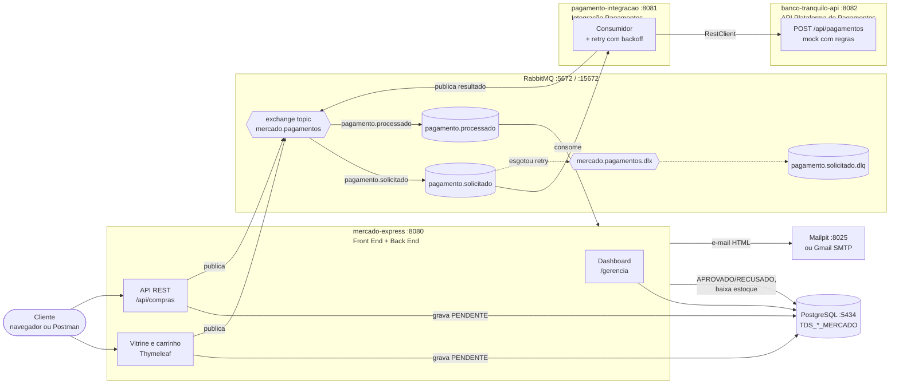
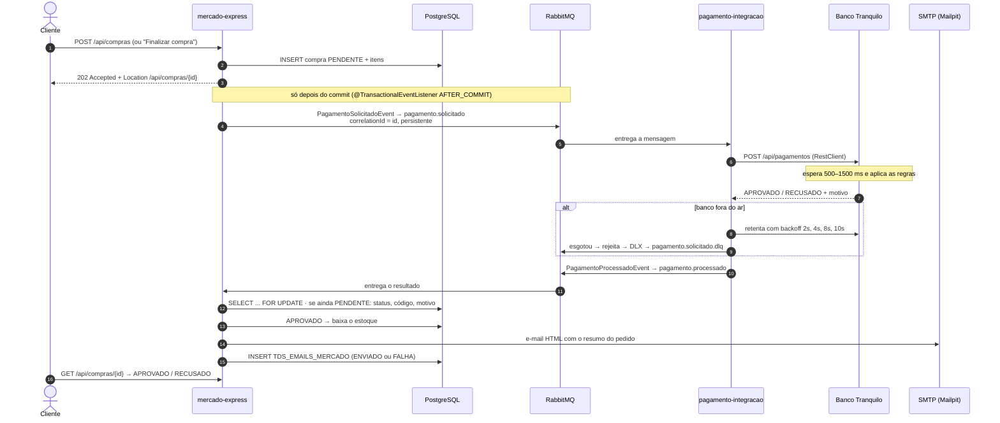

# Mercado Express — Pagamentos com RabbitMQ

**FIAP · TDS · Checkpoint 5 — Parte II (Microsserviços e Mensageria)**
Professor Dr. Marcel Stefan Wagner · Turma 2TDSR

O Mercado Express da Parte I agora vende. O cliente monta o carrinho na
vitrine (ou manda a compra em JSON pelo Postman), a compra é gravada como
**PENDENTE** e a resposta HTTP sai na hora (**202 Accepted**). O pagamento segue
de forma **assíncrona** pelo RabbitMQ até o **Banco Tranquilo**, e o resultado
volta pela fila: a compra vira **APROVADO** ou **RECUSADO**, o estoque baixa, um
e-mail HTML é enviado ao cliente e tudo aparece no **dashboard da gerência**.

```bash
docker compose up --build
```

Esse comando sobe tudo do zero: PostgreSQL, RabbitMQ, Mailpit e os três serviços.

---

## Sumário

1. [Arquitetura](#arquitetura)
2. [Fluxo assíncrono](#fluxo-assíncrono)
3. [Exchanges, filas e routing keys](#exchanges-filas-e-routing-keys)
4. [Regras do Banco Tranquilo](#regras-do-banco-tranquilo)
5. [Criação do projeto](#criação-do-projeto)
6. [Como rodar](#como-rodar)
7. [Endpoints](#endpoints)
8. [JSON de exemplo](#json-de-exemplo)
9. [Configuração do Banco de Dados](#configuração-do-banco-de-dados)
10. [Dashboard de gerência](#dashboard-de-gerência)
11. [Controle de e-mails](#controle-de-e-mails)
12. [Resiliência: retry, DLQ e idempotência](#resiliência-retry-dlq-e-idempotência)
13. [Testes](#testes)
14. [Estrutura do repositório](#estrutura-do-repositório)
15. [Prints](#prints)
16. [Decisões técnicas](#decisões-técnicas)
17. [Integrantes](#integrantes)

---

## Arquitetura

Os blocos seguem o diagrama do enunciado: **Front End / Back End → RabbitMQ →
Integração Pagamentos → API Plataforma de Pagamentos**, e a resposta volta
pelo mesmo broker.



| Serviço | Porta | Papel |
|---|---|---|
| `mercado-express` | 8080 | Vitrine, carrinho, API de compras, consumidor do resultado, e-mail e dashboard |
| `pagamento-integracao` | 8081 | Consome `pagamento.solicitado`, chama o banco e publica `pagamento.processado` |
| `banco-tranquilo-api` | 8082 | API mock da plataforma de pagamentos |
| `mercado-commons` | — | Biblioteca: eventos, nomes das filas e topologia (`Declarables`) |
| PostgreSQL 16 | 5434 → 5432 | Banco do mercado |
| RabbitMQ 3 management | 5672 / 15672 | Broker e painel (`guest` / `guest`) |
| Mailpit | 1025 / 8025 | SMTP de teste e caixa de entrada web |

---

## Fluxo assíncrono



A tela `/pedidos/{id}` mostra esse caminho ao vivo: enquanto a compra está
PENDENTE, ela consulta a API a cada segundo e se atualiza quando o banco responde.

---

## Exchanges, filas e routing keys

Tudo é declarado por `@Bean Declarables` em
[`mercado-commons/.../RabbitTopologiaConfig.java`](mercado-commons/src/main/java/br/com/fiap/mercadocommons/mensageria/RabbitTopologiaConfig.java),
importado pelos dois serviços que usam o broker. Os nomes são constantes em
[`RabbitNomes`](mercado-commons/src/main/java/br/com/fiap/mercadocommons/mensageria/RabbitNomes.java).

| Tipo | Nome | Routing key | Durável | Detalhes |
|---|---|---|---|---|
| Exchange (topic) | `mercado.pagamentos` | — | sim | exchange principal |
| Exchange (topic) | `mercado.pagamentos.dlx` | — | sim | dead letter exchange |
| Fila | `pagamento.solicitado` | `pagamento.solicitado` | sim | `x-dead-letter-exchange=mercado.pagamentos.dlx`, `x-dead-letter-routing-key=pagamento.solicitado.dlq` |
| Fila | `pagamento.processado` | `pagamento.processado` | sim | DLX para `pagamento.processado.dlq` |
| Fila (DLQ) | `pagamento.solicitado.dlq` | `pagamento.solicitado.dlq` | sim | solicitações que esgotaram o retry |
| Fila (DLQ) | `pagamento.processado.dlq` | `pagamento.processado.dlq` | sim | resultados que o mercado não conseguiu aplicar |

| Mensagem | Produtor → Consumidor | Campos |
|---|---|---|
| `PagamentoSolicitadoEvent` | mercado-express → pagamento-integracao | `compraId`, `valor`, `clienteNome`, `clienteEmail`, `clienteCpf`, `numeroCartao`, `titularCartao`, `solicitadoEm` |
| `PagamentoProcessadoEvent` | pagamento-integracao → mercado-express | `compraId`, `status` (APROVADO/RECUSADO), `codigoAutorizacao`, `motivo`, `transacaoId`, `processadoEm` |

Todas as mensagens são JSON (conversor Jackson), **persistentes**
(`delivery_mode=2`) e levam **`correlationId` = id da compra**.

---

## Regras do Banco Tranquilo

Regras determinísticas, avaliadas nesta ordem, para demonstrar os dois casos
sem sorte. Todas podem ser trocadas por variável de ambiente
(`banco-tranquilo-api/src/main/resources/application.yml`) e consultadas em
`GET http://localhost:8082/api/pagamentos/regras`.

| # | Condição | Resultado | Motivo devolvido |
|---|---|---|---|
| 1 | valor **> R$ 5.000,00** | RECUSADO | Valor acima do limite de R$ 5.000,00 por transação |
| 2 | cartão **termina em 0000** | RECUSADO | Cartão recusado pelo emissor |
| 3 | CPF em **`111.111.111-11`, `222.222.222-22` ou `123.456.789-09`** | RECUSADO | CPF com restrição cadastral |
| 4 | qualquer outro caso | **APROVADO** | Pagamento aprovado pelo Banco Tranquilo + código `BTnnnnnn` |

Antes de responder, o banco espera um tempo aleatório entre **500 e 1500 ms**,
para a assincronia ficar visível na tela do pedido.

**Dados prontos para a demonstração**

| Cenário | Cartão | CPF | Itens |
|---|---|---|---|
| Aprovada | `4111 1111 1111 1111` | `529.982.247-25` | qualquer total até R$ 5.000 |
| Recusada (cartão) | `5555 4444 3333 0000` | `529.982.247-25` | qualquer |
| Recusada (CPF) | `4111 1111 1111 1111` | `111.111.111-11` | qualquer |
| Recusada (valor) | `4111 1111 1111 1111` | `529.982.247-25` | 14× Kit churrasco (id 14) + 2× Cafeteira (id 16) = R$ 5.338,40 |

---

## Criação do projeto

Os três serviços foram gerados pela **API do Spring Initializr** (nenhum pom de
serviço foi escrito à mão). Comandos usados, a partir da raiz do repositório:

```bash
BASE="https://start.spring.io/starter.zip"
COMMON="type=maven-project&language=java&bootVersion=4.1.1&javaVersion=21&groupId=br.com.fiap&packaging=jar&version=0.0.1-SNAPSHOT"

# mercado-express: vitrine, carrinho, API, consumidor, e-mail e dashboard
curl -fsS "$BASE?$COMMON&artifactId=mercado-express&name=mercado-express&baseDir=mercado-express&packageName=br.com.fiap.mercadoexpress&dependencies=web,thymeleaf,data-jpa,postgresql,h2,rabbitmq,mail,validation,lombok,actuator" -o me.zip

# pagamento-integracao: consumidor RabbitMQ + RestClient
curl -fsS "$BASE?$COMMON&artifactId=pagamento-integracao&name=pagamento-integracao&baseDir=pagamento-integracao&packageName=br.com.fiap.pagamentointegracao&dependencies=web,spring-restclient,rabbitmq,validation,lombok,actuator" -o pi.zip

# banco-tranquilo-api: API mock
curl -fsS "$BASE?$COMMON&artifactId=banco-tranquilo-api&name=banco-tranquilo-api&baseDir=banco-tranquilo-api&packageName=br.com.fiap.bancotranquilo&dependencies=web,validation,lombok,actuator" -o bt.zip

for z in me pi bt; do unzip -q $z.zip && rm $z.zip; done
```

O commit `chore: projetos gerados pelo spring initializr` guarda os três
projetos exatamente como vieram do Initializr. Depois disso, os poms gerados
receberam só três ajustes: a dependência do `mercado-commons`, o H2 restrito
aos testes e a remoção do `spring-boot-h2console`.

Duas peças **não** vêm do Initializr e foram escritas à mão:

- `pom.xml` da raiz: agregador (reactor) que lista os quatro módulos;
- `mercado-commons/pom.xml`: biblioteca simples (não é aplicação Spring Boot).

> **Spring Boot 4.1.1 em vez de 3.x.** O enunciado fala em Spring Boot 3.x, mas
> hoje o Initializr só gera projetos 4.x. A tentativa com 3.5 devolve
> `Invalid Spring Boot version '3.5.7', Spring Boot compatibility range is >=4.0.0`.
> Como a geração pelo Initializr era obrigatória, usamos a 4.1.1, a mesma
> versão da Parte I.

---

## Como rodar

### Tudo em Docker (um comando)

Pré-requisito: Docker Desktop.

```bash
docker compose up --build
```

| O quê | Endereço |
|---|---|
| Loja (vitrine e carrinho) | http://localhost:8080 |
| Dashboard de gerência | http://localhost:8080/gerencia |
| API de compras | http://localhost:8080/api/compras |
| pagamento-integracao (health) | http://localhost:8081/actuator/health |
| Banco Tranquilo | http://localhost:8082/api/pagamentos/regras |
| Painel do RabbitMQ | http://localhost:15672 (`guest` / `guest`) |
| Mailpit (e-mails) | http://localhost:8025 |
| PostgreSQL | `localhost:5434` (`mercado` / `mercado`) |

Para recomeçar do zero (o volume do banco é apagado e o `script.sql` roda de novo):

```bash
docker compose down -v && docker compose up --build
```

**Porta ocupada?** Todas as portas do host podem ser trocadas num `.env` na
raiz (modelo em [`.env.example`](.env.example)), por exemplo `MERCADO_PORT=18080`.

### Pelo IntelliJ (serviços fora do Docker)

```bash
docker compose up -d postgres rabbitmq mailpit
./mvnw clean install          # compila tudo e instala o mercado-commons
```

Depois rode as classes `BancoTranquiloApiApplication`, `PagamentoIntegracaoApplication`
e `MercadoExpressApplication`. Os `application.yml` já apontam para `localhost`.

---

## Endpoints

### mercado-express (8080)

| Método | Caminho | Descrição |
|---|---|---|
| `POST` | `/api/compras` | Cria a compra: **202 Accepted**, `Location: /api/compras/{id}`, status PENDENTE |
| `GET` | `/api/compras/{id}` | Consulta status, itens, código de autorização, motivo e e-mails enviados |
| `GET` | `/api/produtos` | Catálogo resumido (para descobrir o `produtoId`) |
| `GET` | `/` | Vitrine (filtro por setor) |
| `GET` | `/carrinho` | Carrinho + formulário de finalização |
| `POST` | `/carrinho/adicionar` · `/carrinho/alterar` · `/carrinho/remover` · `/carrinho/finalizar` | Ações do carrinho |
| `GET` | `/pedidos/{id}` | Acompanhamento do pedido em tempo real |
| `GET` | `/gerencia?dias=7\|15\|30` | Dashboard de gerência |

Erros da API seguem o formato ProblemDetail: **400** (validação, com
`campos`), **422** (produto inexistente ou sem estoque) e **404**.

### banco-tranquilo-api (8082)

| Método | Caminho | Descrição |
|---|---|---|
| `POST` | `/api/pagamentos` | Autoriza ou recusa (`compraId`, `valor`, `cpf`, `numeroCartao`, `titular`) |
| `GET` | `/api/pagamentos/regras` | Regras em vigor |

### Postman

Importe [`postman/MercadoExpress.postman_collection.json`](postman/MercadoExpress.postman_collection.json).
Ela traz: listar produtos, **criar compra aprovada**, **consultar status**, **criar
compra recusada** (cartão, CPF e valor), validação 400 e **chamar o banco
direto** (aprovado, recusado e regras). Cada POST de compra guarda o id em
`{{compraId}}` para a consulta seguinte.

---

## JSON de exemplo

`POST http://localhost:8080/api/compras`

```json
{
  "cliente": {
    "nome": "Ana Souza",
    "email": "ana.souza@exemplo.com",
    "cpf": "529.982.247-25"
  },
  "pagamento": {
    "numeroCartao": "4111 1111 1111 1111",
    "titular": "ANA SOUZA"
  },
  "itens": [
    { "produtoId": 1, "quantidade": 3 },
    { "produtoId": 6, "quantidade": 2 }
  ]
}
```

Resposta imediata, **202 Accepted**:

```json
{
  "id": 43,
  "status": "PENDENTE",
  "descricaoStatus": "Aguardando pagamento",
  "origem": "API",
  "clienteNome": "Ana Souza",
  "clienteEmail": "ana.souza@exemplo.com",
  "cartaoFinal": "1111",
  "valorTotal": 67.77,
  "itens": [
    { "produtoId": 1, "produto": "Banana prata", "quantidade": 3, "precoUnitario": 7.99, "subtotal": 23.97 },
    { "produtoId": 6, "produto": "Café torrado e moído", "quantidade": 2, "precoUnitario": 21.90, "subtotal": 43.80 }
  ],
  "codigoAutorizacao": null,
  "motivo": null,
  "emails": [],
  "consulta": "/api/compras/43"
}
```

Cerca de 1–2 s depois, `GET /api/compras/43`:

```json
{
  "id": 43,
  "status": "APROVADO",
  "descricaoStatus": "Pagamento aprovado",
  "codigoAutorizacao": "BT644742",
  "motivo": "Pagamento aprovado pelo Banco Tranquilo",
  "emails": [
    { "destinatario": "ana.souza@exemplo.com", "assunto": "Pedido #43 aprovado | Mercado Express",
      "status": "ENVIADO", "erro": null, "dataEnvio": "2026-10-15T15:37:58.1" }
  ]
}
```

Com `curl`:

```bash
curl -i -X POST http://localhost:8080/api/compras \
  -H "Content-Type: application/json" \
  -d '{"cliente":{"nome":"Ana Souza","email":"ana.souza@exemplo.com","cpf":"529.982.247-25"},"pagamento":{"numeroCartao":"4111 1111 1111 1111","titular":"ANA SOUZA"},"itens":[{"produtoId":1,"quantidade":3}]}'
```

---

## Configuração do Banco de Dados

> O mesmo conteúdo está em [`CONFIG_BD.txt`](CONFIG_BD.txt), na raiz.

| Item | Valor |
|---|---|
| SGBD | PostgreSQL 16 (imagem `postgres:16` do docker compose) |
| Host | `localhost` (de dentro do compose: `postgres`) |
| Porta | `5434` no host → `5432` no container |
| Database | `mercadoexpress` |
| Usuário | `mercado` |
| Senha | `mercado` |
| JDBC | `jdbc:postgresql://localhost:5434/mercadoexpress` |
| Script | [`database/script.sql`](database/script.sql) |

O `script.sql` roda **sozinho** na primeira subida do container (montado em
`/docker-entrypoint-initdb.d`). Para rodar manualmente:

```bash
psql -h localhost -p 5434 -U mercado -d mercadoexpress -f database/script.sql
```

Ele é idempotente (faz `DROP` antes) e cria:

| Tabela | Conteúdo |
|---|---|
| `TDS_PRODUTOS_MERCADO` | Produto da Parte I + `PRECO_VENDA`, `PRECO_CUSTO` e `ESTOQUE_MINIMO` · 16 produtos |
| `TDS_COMPRAS_MERCADO` | Compra, status, cartão (só o final), totais de venda e custo · 42 compras históricas |
| `TDS_ITENS_COMPRA_MERCADO` | Itens com preço e custo congelados na compra · 98 itens |
| `TDS_EMAILS_MERCADO` | Controle de e-mails (destinatário, assunto, compra, status, erro, data) · 42 registros |

As 42 compras históricas (34 aprovadas e 8 recusadas pelas três regras do
banco) usam datas relativas (`CURRENT_DATE - n`). Assim o dashboard mostra
os últimos 30 dias preenchidos em qualquer dia em que o script rodar. Três
produtos ficam abaixo do estoque mínimo de propósito, para o alerta aparecer.

A aplicação usa `ddl-auto: validate`: quem cria o schema é o script, e o
Hibernate só confere o mapeamento. As credenciais chegam por variável de
ambiente (`DB_URL`, `DB_USER`, `DB_PASSWORD`).

---

## Dashboard de gerência

`http://localhost:8080/gerencia` (filtro de 7, 15 ou 30 dias), com Chart.js:

- **KPIs:** faturamento, lucro bruto e margem, ticket médio, pedidos aprovados
  (com taxa de aprovação) e recusados (com pendentes no momento);
- **Vendas por dia:** barras empilhadas de aprovados e recusados;
- **Faturamento x lucro:** duas linhas no mesmo eixo em R$;
- **Top produtos:** receita dos 8 mais vendidos;
- **Status dos pagamentos:** rosca com aprovado, recusado e pendente;
- **Estoque por produto:** barras com o **alerta de estoque baixo** em vermelho,
  mais os cartões de aviso;
- **Últimos e-mails** (de `TDS_EMAILS_MERCADO`) e **compras recentes**.

Lucro = `VALOR_TOTAL − CUSTO_TOTAL` das compras aprovadas. Por isso o
produto ganhou `PRECO_CUSTO`, que é copiado para o item no momento da compra.
As cores foram checadas para daltonismo: verde × vermelho reprovou no
validador, então "recusado" usa laranja e o vermelho fica só para o alerta de
estoque, sempre com ícone e texto.

---

## Controle de e-mails

- Enviados pelo `JavaMailSender` com template HTML Thymeleaf
  (`templates/email/resultado-compra.html`): itens, total, cartão, código de
  autorização ou motivo da recusa e um link para o pedido.
- **Toda** tentativa vira uma linha em `TDS_EMAILS_MERCADO`, com status
  **ENVIADO** ou **FALHA** e a mensagem do SMTP em `ERRO`.
- Falha de SMTP **não derruba o fluxo**. O status da compra é gravado numa
  transação anterior; a exceção do envio é capturada e registrada como FALHA,
  e a mensagem do RabbitMQ é confirmada normalmente.

```sql
SELECT ID, DESTINATARIO, ASSUNTO, COMPRA_ID, STATUS, ERRO, DATA_ENVIO
  FROM TDS_EMAILS_MERCADO ORDER BY DATA_ENVIO DESC;
```

### Trocar o Mailpit por Gmail (e-mail real)

1. Ative a verificação em duas etapas na conta Google.
2. Gere uma **senha de app** em <https://myaccount.google.com/apppasswords>.
3. Crie um `.env` na raiz (o arquivo fica fora do Git):

   ```env
   MAIL_HOST=smtp.gmail.com
   MAIL_PORT=587
   MAIL_USERNAME=sua.conta@gmail.com
   MAIL_PASSWORD=suasenhadeapp16dig
   MAIL_SMTP_AUTH=true
   MAIL_SMTP_STARTTLS=true
   MAIL_FROM=Mercado Express <sua.conta@gmail.com>
   ```

4. `docker compose up -d mercado-express` e faça uma compra com o seu e-mail.

O remetente (`MAIL_FROM`) precisa ser a própria conta autenticada. Se a senha
estiver errada, a compra continua normal e a tabela registra `FALHA` com o erro
de autenticação.

---

## Resiliência: retry, DLQ e idempotência

| Situação | Comportamento |
|---|---|
| Banco Tranquilo fora do ar | `pagamento-integracao` repete a chamada com **backoff exponencial**: 1 tentativa + 4 retentativas (espera de 2 s, 4 s, 8 s e 10 s) |
| Retry esgotado | `DlqLogRecoverer` registra o motivo e rejeita sem requeue; o RabbitMQ manda pela **DLX** para **`pagamento.solicitado.dlq`**, e a compra continua PENDENTE |
| Mesma resposta entregue duas vezes | **Idempotência**: o mercado trava a compra (`SELECT ... FOR UPDATE`) e ignora o resultado se ela já não estiver PENDENTE |
| Banco de dados do mercado fora ao aplicar o resultado | 3 retentativas e depois `pagamento.processado.dlq` (nada se perde) |
| Publicação × commit | `pagamento.solicitado` só é publicado **depois do commit** da compra |
| Estoque | baixa atômica (`UPDATE ... WHERE ESTOQUE >= :qtd`), só na aprovação |

**Demonstrar a DLQ:**

```bash
docker compose stop banco-tranquilo-api
# faça uma compra (Postman, curl ou loja) e acompanhe:
docker compose logs -f pagamento-integracao
# ~25 s depois: painel RabbitMQ → Queues → pagamento.solicitado.dlq (1 mensagem)
docker compose start banco-tranquilo-api
```

Para reprocessar, abra a mensagem no painel (Queues → `pagamento.solicitado.dlq`
→ *Get messages*) e publique de novo na exchange `mercado.pagamentos` com a
routing key `pagamento.solicitado`.

---

## Testes

```bash
./mvnw clean package                  # 4 módulos, 24 testes automatizados
./scripts/teste-fluxo.sh              # ponta a ponta via curl com o compose no ar
./scripts/teste-fluxo.sh --dlq        # + derruba o banco e mostra retry -> DLQ
```

| Módulo | O que os testes cobrem |
|---|---|
| `banco-tranquilo-api` | As três regras de recusa, o limite exato, a aprovação e os endpoints (200 e 400) |
| `pagamento-integracao` | Publicação do resultado e repasse da falha do banco para o retry |
| `mercado-express` | Compra PENDENTE + publicação após o commit com correlationId persistente, aprovação baixando estoque, **idempotência**, recusa sem baixa, **SMTP fora gerando FALHA sem desfazer a compra**, API 202/400/404 e telas (carrinho → finalizar → pedido, `/gerencia`) |

Os testes do mercado usam H2 em memória (perfil `test`) e um RabbitTemplate
simulado, então rodam sem Docker.

---

## Estrutura do repositório

```
mercadoexpress-pagamentos/
├── pom.xml                      # agregador (reactor) dos 4 módulos
├── docker-compose.yml           # postgres, rabbitmq, mailpit + 3 serviços
├── .env.example                 # portas e SMTP (Gmail) configuráveis
├── CONFIG_BD.txt                # configuração do banco de dados
├── integrantes.txt
├── database/script.sql          # DDL + massa de dados
├── postman/MercadoExpress.postman_collection.json
├── scripts/teste-fluxo.sh
├── docs/                        # prints
├── mercado-commons/             # eventos, RabbitNomes, RabbitTopologiaConfig
├── banco-tranquilo-api/         # API mock (Initializr)
├── pagamento-integracao/        # consumidor + RestClient + retry/DLQ (Initializr)
└── mercado-express/             # loja, API, consumidor, e-mail, dashboard (Initializr)
    └── src/main/resources/
        ├── templates/{vitrine,carrinho,pedido,gerencia,email,fragments}
        └── static/{css/app.css,js,img}   # identidade visual da Parte I
```

---

## Prints

<!-- [SUBSTITUIR] Terminal com `docker compose ps` mostrando os 6 containers Up/healthy -->


<!-- [SUBSTITUIR] Painel RabbitMQ (localhost:15672) > Exchanges, com mercado.pagamentos e mercado.pagamentos.dlx -->


<!-- [SUBSTITUIR] Painel RabbitMQ > Queues, com as 4 filas (pagamento.solicitado, pagamento.processado e as duas DLQs) e o gráfico de mensagens -->


<!-- [SUBSTITUIR] Painel RabbitMQ > Exchanges > mercado.pagamentos > Bindings, ou uma mensagem aberta mostrando correlation_id e delivery_mode 2 -->


<!-- [SUBSTITUIR] Vitrine em localhost:8080 com o contador do carrinho preenchido -->


<!-- [SUBSTITUIR] Carrinho com 2+ itens, total na etiqueta e formulário de finalização preenchido -->


<!-- [SUBSTITUIR] Tela /pedidos/{id} logo após finalizar: status PENDENTE com o cronômetro -->


<!-- [SUBSTITUIR] A mesma tela segundos depois: APROVADO, código BT e linha do tempo completa com o e-mail -->


<!-- [SUBSTITUIR] Postman: "2. Criar compra APROVADA" com a resposta 202 Accepted e status PENDENTE -->


<!-- [SUBSTITUIR] Postman: "3. Consultar status" mostrando APROVADO e o e-mail ENVIADO -->


<!-- [SUBSTITUIR] Postman: compra recusada (cartão 0000) e a consulta mostrando RECUSADO e o motivo -->


<!-- [SUBSTITUIR] Postman: "8. Banco Tranquilo direto" com a resposta do mock -->


<!-- [SUBSTITUIR] Mailpit (localhost:8025) com o e-mail "Pedido #N aprovado" aberto -->


<!-- [SUBSTITUIR] Consulta SELECT * FROM TDS_EMAILS_MERCADO no IntelliJ/DBeaver/psql, com ENVIADO e FALHA -->


<!-- [SUBSTITUIR] Dashboard /gerencia completo (KPIs + gráficos) -->


<!-- [SUBSTITUIR] Logs do pagamento-integracao com as tentativas + fila pagamento.solicitado.dlq com 1 mensagem no painel -->


<!-- [SUBSTITUIR] Saída do ./scripts/teste-fluxo.sh -->


---

## Decisões técnicas

- **Spring Boot 4.1.1** em vez de 3.x: o Initializr, que era de uso obrigatório,
  não gera mais 3.x (veja [Criação do projeto](#criação-do-projeto)).
- **`JacksonJsonMessageConverter`**: no Spring AMQP 4 (que vem com o Boot 4), o
  `Jackson2JsonMessageConverter` foi substituído por este conversor, baseado no
  Jackson 3. O formato na fila é o mesmo (JSON + header `__TypeId__`), e o
  conversor só desserializa classes do pacote de eventos do `mercado-commons`.
- **Publicação após o commit** (`@TransactionalEventListener(AFTER_COMMIT)`):
  evita que o resultado chegue antes de a compra existir no banco.
- **Uma DLQ a mais** (`pagamento.processado.dlq`): o enunciado pede a DLQ das
  solicitações; a dos resultados garante que uma resposta do banco não se perca
  se o PostgreSQL do mercado cair.
- **Cartão**: o número completo só passa pela mensagem até o banco mock; no
  mercado fica gravado apenas o final (`CARTAO_FINAL`). Num gateway real a
  mensagem levaria um token.
- **Uma regra para loja e API**: o carrinho Thymeleaf monta o mesmo
  `CompraRequest` da API e chama o mesmo `CompraService`.

---

## Integrantes

| Nome | RM |
|---|---|
| Olavo Porto Neves | 563558 |
| Pedro Henrique França | 561940 |
| Luiz Gonçalves | 564495 |

Turma 2TDSR · Análise e Desenvolvimento de Sistemas · FIAP
